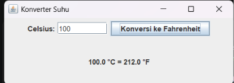

# Konverter Suhu (Java Swing)

Aplikasi GUI sederhana untuk mengubah suhu dari Celsius ke Fahrenheit.

**NIM:** F1D02510083
**Nama:** Muhammad Pasha Andy Lazaro

## Cara Menjalankan

```bash
javac KonvertSuhu.java
java KonvertSuhu
```

## 5 Komponen Utama GUI yang Digunakan

| No | Komponen | Class / Interface | Fungsi di program |
|----|----------|-------------------|-------------------|
| 1 | Top-level Container | `JFrame` | Jendela utama aplikasi |
| 2 | Intermediate Container | `JPanel` | Wadah untuk label, kolom input, dan tombol |
| 3 | Atomic Component | `JLabel`, `JTextField`, `JButton` | Teks keterangan, kolom input suhu Celsius, tombol konversi, dan teks hasil |
| 4 | Layout Classes | `BorderLayout`, `FlowLayout` | BorderLayout mengatur jendela (atas dan tengah), FlowLayout mengatur isi panel secara berurutan |
| 5 | Event Listener | `ActionListener` | Method `actionPerformed()` di-override untuk menghitung dan menampilkan hasil saat tombol diklik |

## Screenshot


